<!-- ╔═══════════════════════════════════════════════════════════════════╗ -->
<!-- ║                XENO STORE — PS5 GAME STORE + DOWNLOADER             ║ -->
<!-- ╚═══════════════════════════════════════════════════════════════════╝ -->

<div align="center">


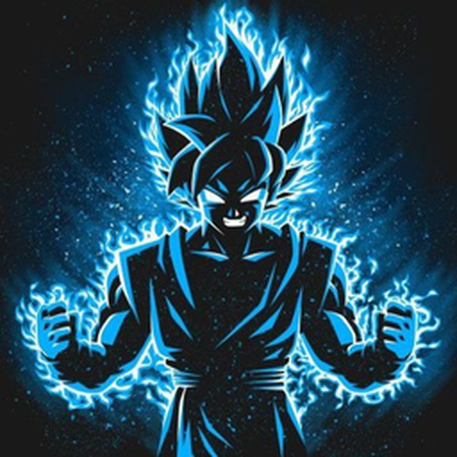

<br/>


<br/><br/>


[](../../releases/latest)
[](../../releases)
[](../../stargazers)
[](../../actions/workflows/build.yml)
[](../../actions/workflows/catalog-sync.yml)


<br/>

### 🟢 [**⬇️  DOWNLOAD XENO STORE  ⬇️**](../../releases/latest)

<sub>`PPSA99500.ffpkg` (the PS5 TV app, store inside) · `xeno-store.elf` (the store) · `XENO-STORE-Desktop` (Windows · Mac · Linux) · `SHA256SUMS`</sub>

</div>

---

<div align="center">

## 💎 What is XENO STORE?

</div>

> **XENO STORE** is a **native PS5 game store and download manager** that runs
> *on the console itself*. Open the **XENO STORE app** from your Games row (or the
> store in the PS5 browser, or on your phone), pick a game, pick a drive, press ✕. The console downloads it
> with up to **16 parallel connections**, verifies it, **installs the package** or
> drops the image where **ShadowMountPlus** finds it, and keeps going while the
> browser is closed. No PC in the loop. 🔥

<div align="center">

<table>
<tr>
<td align="center">🛒<br/><b>1,965</b><br/><sub>games in the catalog</sub></td>
<td align="center">🌍<br/><b>14</b><br/><sub>languages</sub></td>
<td align="center">⚡<br/><b>16</b><br/><sub>connections per download</sub></td>
<td align="center">💾<br/><b>Saves</b><br/><sub>backup · restore · share</sub></td>
<td align="center">📱<br/><b>Phone</b><br/><sub>pair by QR or xeno.local</sub></td>
</tr>
</table>

</div>

---

## ✨ Features

| | Feature | What you get |
|:--:|:--|:--|
| 📺 | **Native TV app** | The Games-row tile opens a **real PS5 app**: GPU-drawn at 1080p, driven with the controller, in the gold-on-dark XENO look. Discover, Browse with filters and search, game pages with every release, Downloads, Library with copy/move between drives, Settings and app updates. It **starts the store by itself** through your ELF loader and never opens a browser over it. [More below](#-the-tv-app). |
| 🛒 | **One big catalog** | **1,965 PS5 + PS4 games / 2,592 releases** merged from a verified catalog feed, Archive.org, dlpsgame, SuperPSX, pkg.games and more, with cover art, screenshots, Metacritic, genres and a **2-hour auto sync** (no app update needed). |
| ⚡ | **Fast downloads** | Segmented transfer with **work-stealing chunks**, per-host adaptive windows, resume with sidecars, mirror failover, **Turbo start** (races mirrors and keeps the fastest), bandwidth limit, schedule window, lifetime stats. Downloads carry on by themselves after an update, a restart, a crash or a power cut. |
| 📦 | **PKG auto-install** | Packages install the moment they finish (native AppInstUtil, with DPI / etaHEN DPI fallback); each download decides for itself, the setting is the default. **Install sets**: game → backport → update → DLC, installed in order, one tap. Optionally deletes the PKG once the console confirms the install. |
| 🧩 | **Images just work** | exFAT / FFPFSC / FFPKG dumps land in `homebrew/` and XENO STORE pokes **ShadowMountPlus** to scan them. ZIP archives are **extracted on the console**. |
| 🔁 | **Backports** | Releases built for lower firmware are tagged with their target firmware; the store offers the right backport for *your* console and lists them in Updates center. |
| 🚀 | **Debrid support** | Connect **Real-Debrid, AllDebrid, TorBox or Premiumize** with your own key and the store unrestricts supported hosts into direct, range-capable links. Keys never leave the console except to the chosen service. |
| 💾 | **Save Data Store** | Community saves for PS5 titles with a **compatibility check** (installed? same region? same version?), one-tap install with automatic pre-backup, and **one-click share** of your own save. |
| 🗄️ | **Saves hub** | Back up any profile's saves to ZIP, restore them, transfer between profiles on the same console, "Back up all saves now". |
| 🏠 | **Homebrew tab** | Apps, emulators and tools listed from pkg-zone with one-tap install and "Update available" badges. |
| 👤 | **Accounts** | Offline account activation (registry slot method), plus the NP fake sign-in companion (sign out from the console's settings) for offline trophies. |
| 🧰 | **Companions** | ShadowMountPlus, package installer daemon, kstuff, app dumper, Garlic — downloaded with a hash check and sent to the local ELF loader. **Readiness checklist** tells you what is still missing. |
| 🕹️ | **Couch-grade UI** | DualSense spatial navigation, PS glyph legend, 7 themes, 14 languages, large-text and high-contrast modes, cover-wall screensaver, command palette on desktop, phone layout with bottom tabs. |
| 🌐 | **xeno.local** | Built-in mDNS answers `http://xeno.local:9095` on your Wi-Fi, so phones and laptops find the console without typing an IP. |
| 🧹 | **Clean uninstall** | Settings → Uninstall removes exactly what the store created (and keeps your games). Ghost-icon cleaner for leftover `/data/homebrew` folders. |
| 🔒 | **No accounts, no telemetry** | Local network only. The only outbound traffic is the catalog / feed sync you can turn off, plus the downloads you start. |

---

## 🏁 Why XENO STORE

<div align="center">

<table>
<tr>
<td align="center" width="25%">⚡<br/><b>Faster</b><br/><sub>16 parallel connections, mirror racing, Turbo start, debrid</sub></td>
<td align="center" width="25%">📦<br/><b>One press</b><br/><sub>download → verify → install, game + backport + update + DLC in order</sub></td>
<td align="center" width="25%">🛡️<br/><b>Never corrupt</b><br/><sub>fsync checkpoints, resume after rest mode, every byte accounted for</sub></td>
<td align="center" width="25%">💾<br/><b>Saves built in</b><br/><sub>backup · restore · transfer · community store</sub></td>
</tr>
<tr>
<td align="center">🕹️<br/><b>Made for the couch</b><br/><sub>a native TV app, controller-first, 7 web themes</sub></td>
<td align="center">📱<br/><b>Phone + PC</b><br/><sub>pair with a 6-digit code or <code>xeno.local</code></sub></td>
<td align="center">🌍<br/><b>14 languages</b><br/><sub>Arabic right-to-left included</sub></td>
<td align="center">🔄<br/><b>Always fresh</b><br/><sub>catalog syncs every 2 h, no reinstall</sub></td>
</tr>
</table>

</div>

---

## 📸 Screenshots

| Discover | Game page | Download options |
|:--:|:--:|:--:|
| 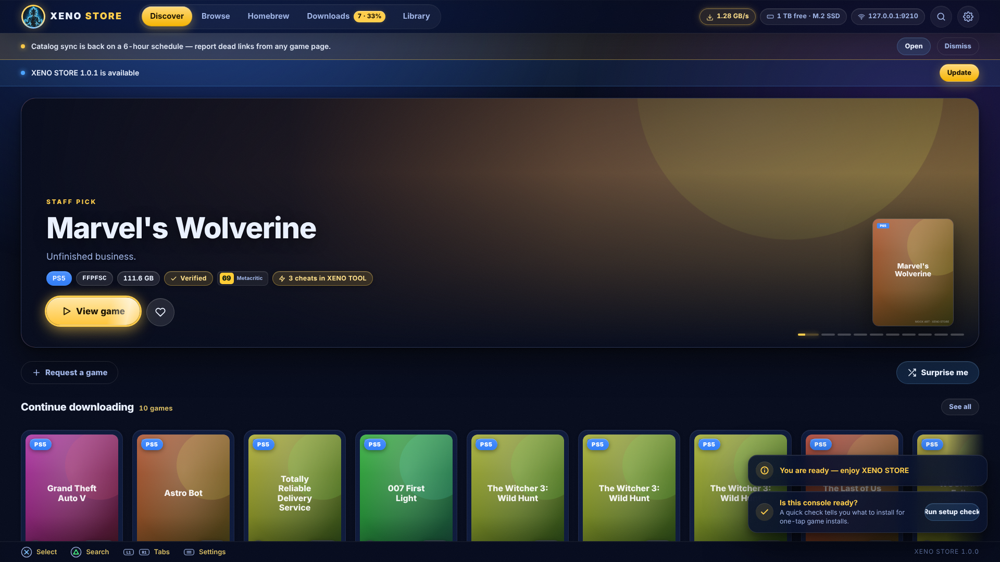 | 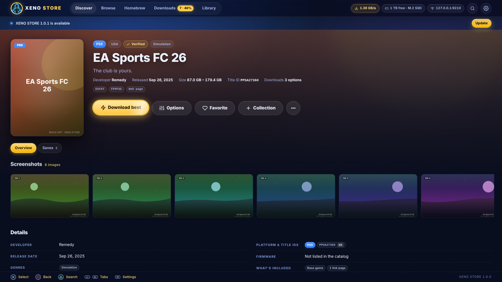 | 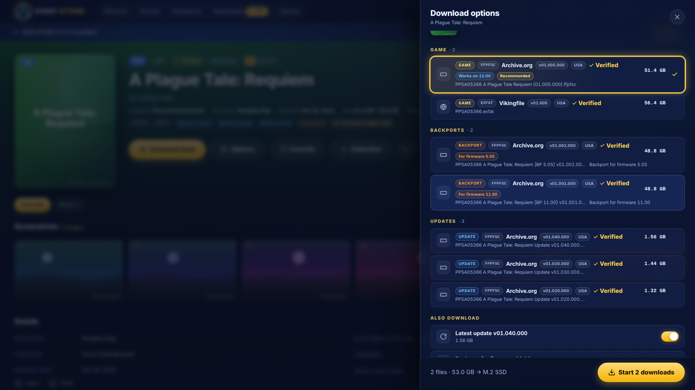 |

| Downloads | Library | Browse facets |
|:--:|:--:|:--:|
| 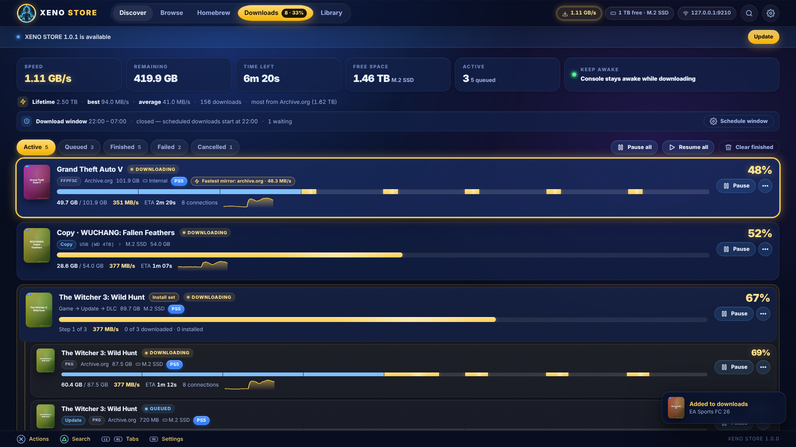 | 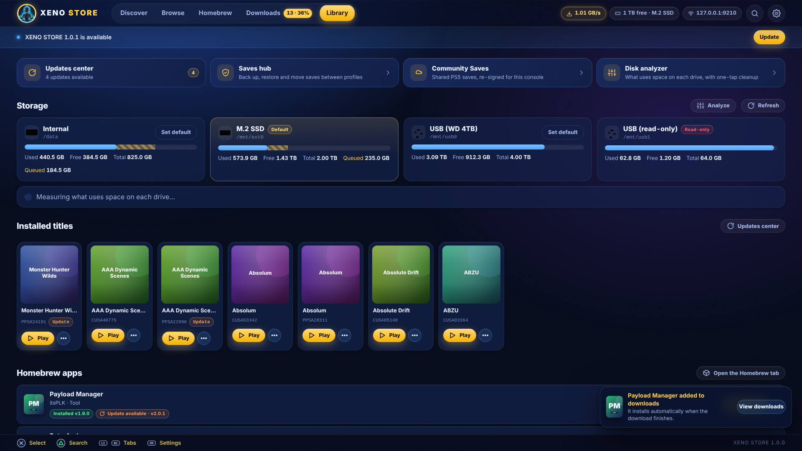 | 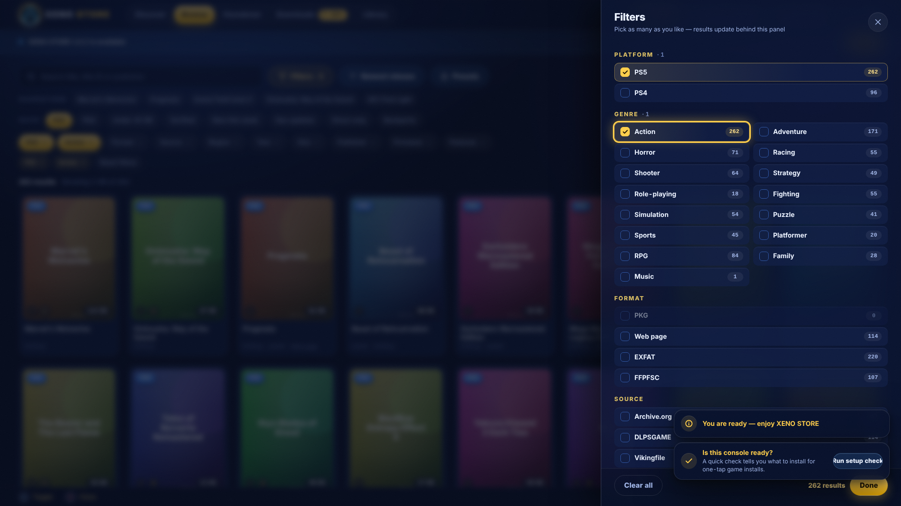 |

| Save Data Store | Homebrew | Settings |
|:--:|:--:|:--:|
| 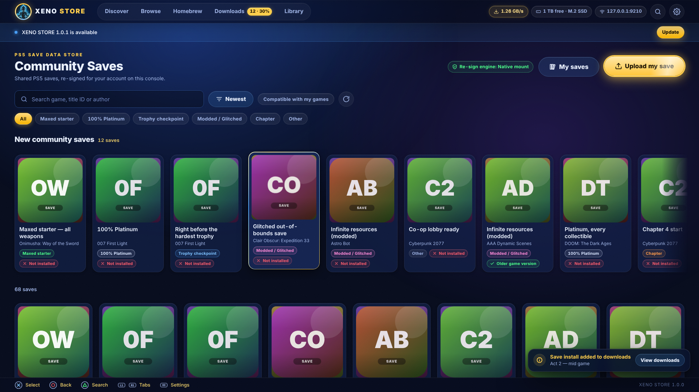 | 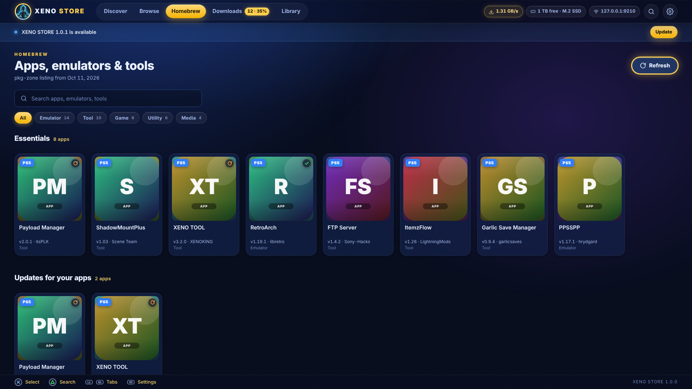 |  |

| Pair a device | Phone layout | |
|:--:|:--:|:--:|
| 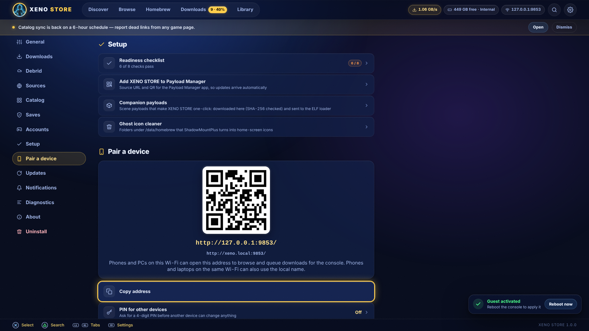 | 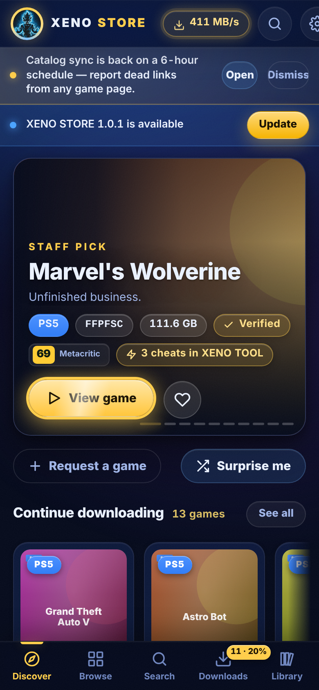 | |

<sub>
1920×1080 captures from the real UI (`docs/screenshots/`); the phone shot is 390×844. These are genuine renders of the shipped build —
the cover art and screenshots you see are <b>neutral placeholders</b> (marked <code>MOCK ART · XENO STORE</code>) because the build machine has no CDN access; on a
real console every tile pulls the actual box art and media from the catalog's art sources.
</sub>

---

## 🚀 Install

You need a jailbroken PS5 with an ELF loader on **port 9021** (etaHEN, the ps5-payload-dev `elfldr`, XENO TOOL's Payloads tab or Payload Manager). The **[latest release](../../releases/latest)** has three things: **`xeno-store.elf`** (the store), **`PPSA99500.ffpkg`** (the XENO STORE TV app for your Games row, with the store inside) and **XENO STORE Desktop** for your PC. `SHA256SUMS` lists the checksum of every file.

### 1 · First time — send `xeno-store.elf`

```text
1.  ⬇️   Download  xeno-store.elf
2.  📡   Send it to your ELF loader / Payload Manager (port 9021)
3.  📺   The store opens on the TV
4.  🎮   Settings → Updates → XENO STORE app → "Install the app"
         The XENO STORE app appears under Games by itself
```

<sub>Rather do it by hand? Copy <code>PPSA99500.ffpkg</code> to <code>/data/homebrew/</code> (FTP, USB or XENO TOOL) and ShadowMountPlus mounts it. The app needs kstuff + ShadowMountPlus, like every <code>.ffpkg</code> app. Once it is installed, a store started from your ELF loader or Payload Manager opens the XENO STORE app instead of the browser (the browser only when the app is missing or doesn't start). Don't want anything to open when the store starts? Settings → General → <i>Open XENO STORE when it starts</i>.</sub>

### 2 · After that — the XENO STORE tile

```text
1.  🎮   Games → XENO STORE → ✕
         The TV app opens; if the store is not running yet, it starts it through
         your ELF loader (port 9021) and carries on as soon as the store answers
2.  🔄   Updates: Settings → Updates (in the app or the web UI)
         The store and the TV app each have their own card; the app starts the
         new store by itself from then on
```

The store also adds a **XENO STORE Web** shortcut on the PS5 that opens it in the browser. On your phone or laptop, open `http://<ps5-ip>:9095` or `http://xeno.local:9095`.

### 3 · On your PC — `XENO-STORE-Desktop` (Windows · macOS · Linux)

```text
1.  ⬇️   Download the Desktop archive for your system and run XENO-STORE-Desktop
2.  🔎   "Search my network" finds your PS5 (or type its IP)
3.  🔔   "Show code on my PS5" → the code pops up as a PS5 notification → type it
4.  🛒   "Open XENO STORE": the whole store in your PC browser, every download goes to the PS5
5.  📤   "Send from this PC": pick a .pkg / .ffpkg / .ffpfsc / .exfat / .zip / .rar / .7z on your PC
         and the PS5 pulls it over your network with its fast downloader, then installs it
```

<sub>A phone or a PC browser that opens <code>http://&lt;ps5-ip&gt;:9095</code> directly gets the same <b>Link to your PS5</b> page first. macOS may ask you to allow the app in System Settings → Privacy &amp; Security the first time.</sub>

### 🔁 Auto-start — Payload Manager

Add this URL as a **source** in Payload Manager and enable auto-start for **XENO STORE**, so the download service is up after every boot:

```text
https://raw.githubusercontent.com/XENOKING123/XENO-STORE/main/updates/payloads.json
```

<sub>Settings → Setup shows the same URL as a QR code. Every release writes the sha256 of the ELF into that list, so Payload Manager verifies what it downloads.</sub>

> 💡 **Updates** are built in: Settings → Updates → *Check* → *Install update* downloads the new version, checks its sha256 and keeps it for the next start (*Restart now* switches right away).

---

## ✅ First run & readiness checklist

The welcome sheet asks three things: which **sources** you want to see, which **drive** downloads go to, and a notice you acknowledge once. After that **Settings → Setup** runs a checklist (also available any time):

| Check | Why it matters | Fix offered |
|:--|:--|:--|
| ShadowMountPlus (running, or its API on `127.0.0.1:10101`) | Mounts exFAT / FFPFSC dumps so they show on the home screen | **Launch ShadowMountPlus now** when a copy is on the console, or install it from Companions |
| Package installer (`:9040`) | Fallback for PKG install when the native call is refused | Install the companion daemon |
| etaHEN DPI (`:12800`) | Optional second fallback | Load etaHEN before the store |
| Internet | Catalog sync, cover art, downloads | Shows the exact host that failed |
| Default drive writable + free space | Nothing starts without room (256 MB reserve + the file) | Pick another drive / Disk analyzer |
| Firmware | PS5 fake packages (FPKG) need a supported firmware — **11.60 or lower as of October 2026** | Explains what still works on newer firmware (images via ShadowMountPlus, homebrew PKGs, saves) |
| Payload Manager | Auto-start on boot | QR + URL of `payloads.json` |

---

## 📺 The TV app

The XENO STORE tile in your Games row is a **native PS5 app** (`PPSA99500`), not a browser page. It is drawn on the
console's GPU at 1920×1080, driven with the controller, and uses the store's gold-on-dark look.

| Screen | What you get |
|:--|:--|
| **Discover** | Featured games with full-width hero art, *New on XENO STORE*, the latest releases and every game |
| **Browse** | The whole catalog with filters (PS5 / PS4, format, region, favourites) and an on-screen search keyboard |
| **Game page** | Description, every release (game, backport, update, DLC) with format, size, region and version, and the drive it goes to |
| **Downloads** | Live progress, speed and retry countdowns; pause, resume, retry, cancel (keep or delete the partial) and archive passwords |
| **Library** | Games on every drive, installed titles, free space per drive, copy or move a game image to another drive |
| **Settings** | Download sources, default drive, the pairing code for your phone, catalog refresh, updates for the store and the app, *Restart download service* |

**How it installs.** Settings → Updates → *XENO STORE app* → *Install the app* (web UI) downloads `PPSA99500.ffpkg` from the
latest release, checks its SHA-256 and puts it in `/data/homebrew/`, where ShadowMountPlus mounts it and adds the
tile. From then on the app keeps itself current: **App settings → Updates → TV app** in the app installs a new version, which opens
the next time you start it. The web UI's card says **Update available** when a newer app is published and offers **Update the app**.
Copying `PPSA99500.ffpkg` to `/data/homebrew/` by hand works too.

**How it starts.** The image carries the store as `xeno/xeno-store.elf`. When you open the app and nothing answers on
`127.0.0.1:9095`, it sends the store to your ELF loader on port **9021**: the update you downloaded
(`/data/xeno-store/xeno-store.elf`) when it is newer, otherwise the copy inside the app. The store notices the app
and **does not open the browser** over it. If a downloaded update fails to come up, the next try uses the copy inside
the app. **Restart download service** pauses your downloads and restarts the store the same way; they then continue on
their own (unless *Resume after a restart* is off in the web UI's Settings → Downloads). The other way round, a store
started from your ELF loader or Payload Manager opens the app when it is installed.

**One store everywhere.** The app talks to the same store as your phone and PC (through its own `/api/v1` dialect,
see `docs/API.md` §13), so the queue, favourites, drives and settings are shared. Languages: English, German,
Spanish, French, Hungarian, Italian, Dutch, Polish, Brazilian Portuguese, Russian and Turkish (Arabic, Japanese,
Korean and Chinese show English in the app for now).

<sub>The TV app is based on Orbit Store's TV app (saawant12/orbit-store-ps5) and BlackBearReloaded's ps5-homebrew-ui
(GPL-3.0). Its source and every licence are in <code>app/tv/</code> (<code>app/tv/NOTICE</code>), and each release
attaches <code>XENO-STORE-&lt;version&gt;-tv-sources.tar.gz</code> with the complete source it was built from.</sub>

---

## 🎮 Controls

| Button | Action |
|:--:|:--|
| **D-pad / left stick** | Move focus (rails scroll, grids are virtualized) |
| **✕** | Select / Download |
| **○** | Back (also closes sheets and the gallery) |
| **□** | Favorite the focused game |
| **△** | Search |
| **L1 / R1** | Previous / next tab (Discover · Browse · Saves · Downloads · Library · Homebrew) |
| **Options** | Settings |
| **L2 held while the store opens** | **Safe mode** — no animations, sounds or online enrichment (also a Settings toggle) |
| **Settings → General → Swap ✕/○** | Japanese layout |

Keyboard (phone / desktop): arrows, Enter, Esc, `F` favorite, `Q`/`E` tabs, `/` search, `?` shortcuts, `Ctrl/Cmd+K` command palette. Mouse and touch work everywhere.

In the **TV app** the same buttons apply (D-pad, **✕** select, **○** back, **L1 / R1** tabs: Discover · Browse · Saves · Library · Downloads, **L2 / R2** jump a screen through the game grids); the bottom bar always shows what each button does on the current screen.

---

## 📂 Formats

| Format | What happens after download | Needs |
|:--|:--|:--|
| **PKG / FPKG** | Saved to `<drive>/xeno-store/pkg/` and **installed automatically** (native → DPI `:9040` → etaHEN DPI `:12800`). Install sets install game → backport → update → DLC in order. | FPKG: firmware ≤ 11.60 + kstuff/etaHEN as of Oct 2026 |
| **exFAT · FFPFSC · FFPKG · FFPFS** | Saved to `<drive>/homebrew/` and ShadowMountPlus is asked to scan. | ShadowMountPlus |
| **ZIP** | Saved to `<drive>/xeno-store/files/` and **extracted on the console** (folder dumps → `homebrew/<name>/`, single images straight to the image file); the archive is deleted after a successful extract (both toggles in Settings). | — |
| **RAR · 7z** | Downloaded only — there is no RAR/7z engine in the payload. The UI says so and points to XENO TOOL on the desktop to extract and send. | XENO TOOL |
| **PAGE** | A web page that lists mirrors: **Get links** resolves direct files server-side where allowed, or **Open on PS5 browser**; human checks (Vikingfile-style) finish in the browser and you paste the file link with **Enter file link** — from the TV or your phone. | — |

Full details, paths and sidecar formats: [`docs/FORMATS.md`](docs/FORMATS.md).

---

## 💾 Save Data Store


A community library of PS5 saves — the collection of the **XenoKing** site, each save credited to the player who shared it, plus the reviewed GitHub index: maxed starters, 100% platinums, trophy checkpoints, chapter picks — **re-signed for your account on this console** so they load like your own. Every save is checked before it touches your card:

* **Compatibility first.** Each card shows whether the game is **installed**, whether its **region** matches and whether the **version** lines up; "Compatible with my games" filters the grid to saves you can actually use.
* **Honest re-sign tiers.** The store reports the engine it will use, never fakes it: **Garlic** ([Garlic Save Manager](https://github.com/earthonion/garlic-savemgr) on `:8082`, started on demand from the author's sha256-pinned release — or, offline, a copy on the console — never rehosted) re-signs community saves for your profile, and **Raw** (a same-console copy) restores your own backups. The native save-API tier is disabled on the console. The current tier is shown on the header pill.
* **Safe installs.** Downloads are sha256-checked whenever the listing carries a hash, the install **backs up your current save first**, and a save for the wrong title id is refused outright.
* **Share yours in one flow.** *Upload my save* exports the chosen save, strips the account id, uploads it to the XenoKing site and adds it to the site's collection under your nickname — **live on the site and in every store at once** (a pre-filled GitHub submission is the fallback when the site is unreachable).

The **Saves** tab is a main section of its own: the community store, plus **Saves hub** (from the Saves tab or Library) which backs up any profile to ZIP, restores it, transfers saves between profiles on the same console, and has a "Back up all saves now". Full walkthrough: [`docs/SAVES.md`](docs/SAVES.md).

---

## 🚀 Debrid

Connect **Real-Debrid, AllDebrid, TorBox or Premiumize** with your own API key (Settings → Debrid). When a release points at a host your service supports, XENO STORE **unrestricts it into a direct, range-capable link** and the segmented engine downloads it at full speed with resume — no browser step, no waiting-room page.

* The key is validated against the service's own user endpoint before it is stored, and it **never leaves the console** except to the service you chose.
* Supported hosts are resolved transparently; unsupported links fall back to the normal flow (direct download, or **Enter file link** for pages that need a human check).
* Add or forget a key any time; forgetting it clears it from the console immediately.

---

## 📱 Phone pairing


Settings → **Pair a device** shows a QR code and the two addresses `http://<ps5-ip>:9095` and `http://xeno.local:9095`.
A phone or PC that opens one of them lands on **Link to your PS5** first: press **Show code on my PS5**, read the 6-digit code from the PS5 notification, type it, done — once per browser.
Scan it with any phone on the same Wi-Fi: same store, phone layout, bottom tabs. Everything works from the phone —
browse, queue, pause, **Enter file link** (paste the link you unlocked in a mobile browser), the Save Data Store upload wizard,
and "Add to home screen" via the PWA manifest.

**Proving the phone is in the room.** When a device changes anything on the console, the store can ask it to pair with a **6-digit code**:

```text
1.  🔢   The console shows a 6-digit code as a PS5 toast (Pair a device → "Show code" re-shows it, 30 s cooldown)
2.  📲   On the phone, open the store, enter the code
3.  🔑   The phone gets a bearer token, and from then on it acts without re-entering
```

The literal code is only ever returned to the console's own browser (loopback); a phone must read it off the TV, so a device that cannot see the screen cannot pair. An optional 4-digit **PIN** in Settings → Pairing adds a second gate for every mutating request. The console browser and the TV app are trusted automatically via the console's own session (`/api/session`), which is never listed or unpaired.

**Paired devices.** Settings → Pair a device lists every paired phone and PC (its name, when it was last seen, *This device*) with **Unpair** and **Unpair all other devices**. Up to 16 stay paired; pairing one more replaces the device unused the longest and tells you which. An unpaired device is cut off at once and its Link page says why; XENO STORE Desktop opens its own link page.

---

## ❓ FAQ

<details>
<summary><b>Does it need XENO TOOL on a PC?</b></summary>
<br/>
No. XENO TOOL is one convenient way to <i>send</i> the ELF; after that the store is self-contained. XENO TOOL is still handy for RAR/7z extraction and for sending files from a PC.
</details>

<details>
<summary><b>Where do the games come from? Do you host them?</b></summary>
<br/>
No. The catalog lists releases published by the sources in <code>catalog/sources.json</code> (Archive.org items, a verified catalog feed, game sites). XENO STORE downloads straight from them; it never hosts, re-uploads or proxies game files.
</details>

<details>
<summary><b>Why does a release say "Open on PS5 browser"?</b></summary>
<br/>
Some hosts require a human check or a page with mirrors. XENO STORE does not bypass CAPTCHAs. Finish the page in the browser (TV or phone), copy the direct link and use <b>Enter file link</b>.
</details>

<details>
<summary><b>Will my console sleep during a 100 GB download?</b></summary>
<br/>
Not while "Keep console awake" is on (default): the store ticks the power service every 30 s while anything downloads. If you put it to rest anyway, downloads resume from their checkpoints when the network comes back.
</details>

<details>
<summary><b>Is the Save Data Store safe to use?</b></summary>
<br/>
It lists the XenoKing site's community collection and the reviewed GitHub index (<code>published</code> entries only), checks the sha256 of every download that has one, refuses saves for a different title ID, warns when the game version differs, and backs up your current save before installing. Saves you share go into the XenoKing collection only after the console has checked they are a real decrypted export without your account ID or sealed keys. Re-signing goes through Garlic Save Manager on <code>:8082</code> (started on demand), or a same-console raw copy for your own backups — the tier in use is shown, never faked.
</details>

<details>
<summary><b>What does the host build do?</b></summary>
<br/>
<code>make host</code> builds the same C code for Linux/macOS with the PS5 calls stubbed (installs "succeed" after 3 s, saves mount to temp folders). It exists for tests and for working on the UI without a console; it is not a game downloader for PCs.
</details>

<details>
<summary><b>Is this legal?</b></summary>
<br/>
XENO STORE is a GPL-3.0 download manager and catalog browser. Only download content you have the right to use. See the disclaimer below.
</details>

---

## 🛠️ Troubleshooting

| Symptom | What to do |
|:--|:--|
| "XENO STORE already running on :9095" toast | A copy is still running — just open the address. Use Settings → Updates → *Stop XENO STORE* before sending a new ELF. |
| "XENO STORE restarted after a problem" toast | The store stopped by itself last time. Settings → Diagnostics shows the report (what was running, the network step); copy it into an issue. That session starts safe: automatic catalog / update checks stay off, everything you start still works. |
| "Downloads unavailable on this firmware" | The network libraries did not load (`libSceHttp` / `libSceSsl`). Browsing still works; retry after a reboot and report your firmware in an issue. |
| Download fails with *provider_page* | The host answered with a web page instead of the file. Open the page and use **Enter file link**. |
| *source_changed* | The file on the server changed under a paused download. **Restart** from zero or choose another source. |
| *no_space* | Needs the file + 256 MB reserve on that drive. Library → Disk analyzer → *Clean up partials*, or pick another drive. |
| PKG shows *Install failed* | Check Settings → Setup: the native installer was refused (firmware) and no DPI daemon answered. Install the companion daemon or load etaHEN, then press **Install** on the job. |
| Image downloaded but no icon on the home screen | ShadowMountPlus is not running — the checklist offers **Launch ShadowMountPlus now**. |
| Phone cannot open `xeno.local` | Some Android browsers ignore mDNS; use the IP shown next to it. Guest Wi-Fi networks often block device-to-device traffic. |
| Store looks wrong / stuck after an update | Settings → Diagnostics → *Export settings*, then reload the page once (the UI is cached with an ETag). |

More in [`docs/GUIDE.md`](docs/GUIDE.md#troubleshooting).

---

## 🧰 Build from source

<details>
<summary><b>Click to expand</b></summary>

<br/>

```bash
make web        # node web/build.mjs            → web/dist/index.html (single file, ES2017, no deps)
make catalog    # tools/catalog/build_catalog.py --offline + --validate → catalog/xeno-catalog.json
make assets     # tools/gen_assets.py           → src/assets.h (UI + catalog + logo + icon, gzip variants)
make host       # host binary build/host/xeno-store (-DXENO_HOST=1, OpenSSL when pkg-config finds it)
make test       # make host + tests/host/run.sh  (100+ tests across 5 suites)
make ps5        # xeno-store.elf (needs PS5_PAYLOAD_SDK)
make ps5-check  # compile-only check of every PS5 translation unit
make eboot      # app/native-launcher/build.sh  → app/dist/eboot.bin (the fallback native launcher)
make tv-deps    # the TV app's pinned SDK, libwebp, ps5-opengl and GoogleTest → app/tv/.deps
make tv         # the TV app folder app/tv/dist/PPSA99500 (runs make tv-check first)
make tv-test    # the TV app's unit tests (ASan + UBSan)
make tv-preview # every TV app screen rendered on this machine (Mesa llvmpipe) → app/tv/build/preview/pictures
make tv-preview-live  # every screen against the host build of the store → build/tv-preview/index.html
make ffpkg      # tools/make_ffpkg.py           → dist/PPSA99500.ffpkg: the TV app + xeno/xeno-store.elf when
                #                                  app/tv/dist/PPSA99500 is built, else the native launcher (needs makefs)
make all        # web catalog assets ps5 eboot tv ffpkg — what a release ships (tv only where its toolchain is set up)
make clean      # build outputs (distclean also removes web/dist)
```

**Requirements:** gcc or clang, make, Python 3.10+ (stdlib only; `make test` also needs Pillow 11.3 or newer, which writes WebP and AVIF: `pip install Pillow==11.3.0`), Node 22 (no npm packages), OpenSSL dev headers for HTTPS in the host build,
and the [ps5-payload-dev SDK](https://github.com/ps5-payload-dev/sdk) v0.40 with LLVM 18 for `make ps5`:

```bash
export PS5_PAYLOAD_SDK=/opt/ps5-payload-sdk
make ps5 eboot ffpkg
```

Compiler flags are `-std=gnu11 -Wall -Wextra -Werror -O2 -fstack-protector-strong`. The PS5 build links only libraries proven to load on every firmware
(`SceSystemService`, `SceUserService`, `SceIpmi`, `SceAppInstUtil`, `SceNotification`, `kernel_sys`); everything else (`libSceHttp`, `libSceSsl`, `libSceNet`, `libSceSaveData`, registry, launcher) is resolved at runtime with `dlsym` and degrades gracefully.

**TV app:** clang-18, lld-18, llvm-18 and `libclang-rt-18-dev`, ninja, wget, unzip and python3; the tests and previews also need `libwebp-dev`, Mesa (`libegl-dev`, `libgl-dev`, `libegl-mesa0`, `libgl1-mesa-dri`) and `python3-pil`. `make tv-deps` fetches and hash-checks everything else. `make all` builds the TV app only on a machine with clang-18 and the fetched dependencies (`TV=1` forces it, `TV=0` skips it); elsewhere `make ffpkg` packs an app folder you already have (for example the `tv-app` CI artifact built for the same `VERSION`; a folder built for another version is refused) or the native launcher. See `docs/SPEC.md` §19 and `tools/tv/README.md`.

UI development without a console: `node web/dev-server.mjs --port 9095` serves the bundle with a mock of the whole API, and `web/verify-ui.mjs` runs the Playwright walk (screenshots + keyboard-only flow + "no console errors").

</details>

---

## 🔄 Catalog sync & audit

* **`catalog-sync.yml`** runs every 2 hours (`17 */2 * * *`) and on demand: `build_catalog.py --online` scrapes every source with a per-source time budget (a broken site falls back to its last good data, never breaks the build), then `audit.py --budget-seconds 1500` checks release links (Archive.org metadata with sizes and hashes, `HEAD` + 1-byte `Range` for direct hosts, "does the page still mention the game" for page sources), then `--validate` guards the result. Changes are committed as `catalog: sync (revision N) [catalog-sync]`.
* **Audit verdicts** are `ok`, `flaky`, `dead` and `page`; `dead` links are dropped at the next build, `release.health` is set and `game.verified` means "at least one direct release audited ok". Results live in `catalog/snapshots/audit/results.json` and are re-checked after 7 days.
* The console checks `catalog/revision.json` every 6 hours (Settings → Catalog → Auto-refresh) and downloads the new catalog only when the revision grew; `updates/featured.json`, `messages.json`, `companions.json` and `saves-backend.json` ride along, so Discover rows, announcements and companions change **without an app update**.
* **`build.yml`** builds the UI, builds + validates the catalog, runs the host tests, builds and tests the TV app (unit tests, fixture previews and a live preview against the host build, uploaded as `tv-preview-live`), cross-compiles `xeno-store.elf`, builds `PPSA99500.ffpkg` (the TV app with the store inside) and XENO STORE Desktop, and on `main` publishes the `v<VERSION>` release (the app, the ELF, one Desktop download per OS, the TV app's source bundle and `SHA256SUMS`), then writes the ELF's hash into `updates/payloads.json` and the app's into `updates/tv-app.json`.

---

## 🏆 Credits

<div align="center">

**XENO STORE stands on the shoulders of the scene.** Thank you to everyone below — please support their projects too.

**The TV app is based on Orbit Store's TV app (saawant12/orbit-store-ps5) and BlackBearReloaded's ps5-homebrew-ui (GPL-3.0).**

| Project / person | What we learned or use |
|:--|:--|
| **[ps5-payload-dev SDK](https://github.com/ps5-payload-dev/sdk)** — John Törnblom | The toolchain every payload here is built with, `elfldr`, `websrv`, `offact` |
| **[LightningMods](https://github.com/LightningMods)** | etaHEN, ShadowMount and the DPI protocol that make one-tap installs possible |
| **[maj0r / CheatRunner](https://discord.gg/E4g6fEqp46)** | The on-console cheat engine behind the "⚡ cheats in XENO TOOL" chips |
| **Cheat creators** — LM, Buzzer, Super Death, GoldHEN Team, Yharnam, PS4Trainer and everyone in the etaHEN & GoldHEN communities | The cheat database that powers those counts |
| **[hejran7](https://github.com/hejran7)** | Major coding work across the XENO projects |
| **[Archive.org](https://archive.org)** | Hosting with Range support, metadata, sizes and hashes |
| **[dlpsgame](https://dlpsgame.com)** and the other game sites in `catalog/sources.json` | Listings, mirrors and versions |
| **[prosperopatches](https://prosperopatches.com) / [orbispatches](https://orbispatches.com)** | Cover and hero artwork CDN |
| **[Garlic Save Manager](https://github.com/earthonion/garlic-savemgr)** — earthonion | The save re-signing worker the store starts on demand (the author's own release, sha256-pinned, never rehosted) and the decrypted-save ZIP layout the Save Data Store stays compatible with |
| **[Garlic Save DB](https://garlicsaves.com)** | Community saves the XenoKing site mirrors |
| **[offact](https://github.com/ps5-payload-dev)** | The offline account activation method vendored in this repo |
| **[earthonion / np-fake-signin](https://github.com/earthonion/np-fake-signin)** | NP fake sign-in companion (sign out from the console's settings) |
| **[miniz](https://github.com/richgel999/miniz)** | The single-file ZIP engine used for extraction and save backups |
| **[ps5upload](https://github.com/phantomptr/ps5upload)** (phantomptr, GPL-3.0) | The `fpkg_build` engine `tools/make_ffpkg.py` can use for a local `.pkg` build of the app |
| **[ShadowMountPlus](https://github.com/drakmor/shadowMountPlus)** | Mounts the `.ffpkg` app; its documented UFS2 profile is what `make ffpkg` writes |
| **[ps5-native-app-boilerplate / ps5-homebrew-ui](https://github.com/blackbearreloaded/ps5-homebrew-ui)** — BlackBearReloaded (GPL-3.0-or-later) | The UI kit, renderer, controller and sound layer the TV app is built on (`app/tv`), and the native app toolchain (`app_crt.cpp`, the PIE layout, `ps5-native-tool`, the clean-room `libc.prx` module) both apps ship with |
| **[SharpProspero](https://github.com/SvenGDK/SharpProspero)** — SvenGDK (GPL-3.0) | The FSELF and module-writer work `ps5-native-tool` is derived from |
| **[Orbit Store](https://github.com/saawant12/orbit-store-ps5)** — saawant12 (GPL-3.0-or-later) | The TV app: XENO STORE's native app in `app/tv` is its 1.2.0 TV app, ported to our backend, brand and paths (provenance and changed files in `app/tv/NOTICE`) |
| **[ps5-opengl SDK](https://github.com/blackbearreloaded/ps5-opengl)** — BlackBearReloaded (GPL-3.0-or-later), **[libwebp](https://chromium.googlesource.com/webm/libwebp)** (BSD-3-Clause), **LLVM** libc++ / libunwind / compiler-rt (Apache-2.0 with LLVM exception), **[stb](https://github.com/nothings/stb)**, **[Inter](https://rsms.me/inter/)** (OFL-1.1) | The TV app's OpenGL layer, artwork decoding, C++ runtime, image loading and typeface (`app/tv/licenses/`) |
| **ps5-payload-sdk `install_app` sample** — John Törnblom (GPL-3.0) | `make_fself.py` and the app linker script behind the old freestanding launcher (`make eboot-raw`) |
| **[makefs](https://man.netbsd.org/makefs.8)** (NetBSD / FreeBSD) | Builds the UFS2 `.ffpkg` image on Linux without mounting anything |
| **[qrcode-generator](https://github.com/kazuhikoarase/qrcode-generator)** — Kazuhiko Arase (MIT) | Pairing and share QR codes |

</div>

---

## ⚠️ Disclaimer

XENO STORE is a download manager and catalog browser. It does **not** host, distribute or sell games, and it does not bypass DRM, CAPTCHAs or access controls.
Content listed by third-party sources is their responsibility; you are responsible for complying with the laws of your country and for owning the games you download.
Modifying a console can void its warranty and may violate the platform holder's terms. The authors accept no liability for data loss, bans or hardware damage. **Back up your saves before using Accounts or the Save Data Store.**

<div align="center">

## ⚖️ License

**GNU GPL-3.0-or-later** — see [`LICENSE`](LICENSE). Third-party notices are in `src/third_party/README.md`, `app/tv/NOTICE` (the TV app: Orbit Store's TV app, ps5-homebrew-ui and every linked component), `app/native-launcher/NOTICE` (the native launcher's toolchain and its `libc.prx` module) and the in-app **About** screen.

<br/>


<sub>⭐ If XENO STORE replaced a PC in your workflow, drop a star — it helps more people find it. ⭐</sub>

</div>
